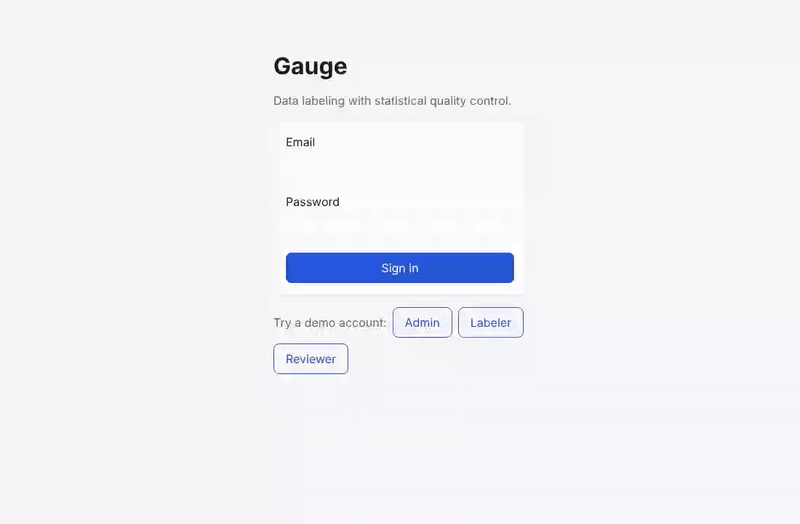
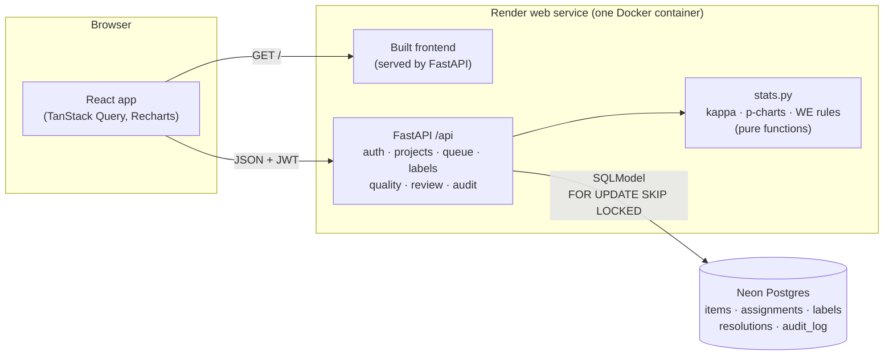

# Gauge

A data-labeling platform that monitors labeler quality the way a factory monitors a
production line.

Training data is only as good as the people who label it. Gauge mixes hidden **gold
questions** (known answers) into each labeler's queue, sends some items to several
labelers to measure **agreement**, and puts every labeler's error rate on a **control
chart**, so someone drifting out of control gets flagged before their labels reach the
dataset. The name comes from *Gauge R&R*, the measurement-system analysis quality
engineers use on factory gauges.



**Try it:** [the live demo](https://gauge-w270.onrender.com) runs on Render's free tier, so the first request after a
quiet spell takes about a minute while the server wakes up. Sign in with one of the
demo accounts on the login page.

## Stack

| Layer | Tools |
|---|---|
| API | Python 3.12, FastAPI, SQLModel, Alembic, Pydantic, JWT auth with roles |
| Database | Postgres 16 |
| Frontend | React, TypeScript, Vite, TanStack Query, React Router |
| Tests and CI | pytest against real Postgres, Vitest with Testing Library, ruff, oxlint, Prettier, GitHub Actions |

## Architecture



A labeler asks for the next item; the queue picks a gold item with probability
`gold_rate`, otherwise the next regular item that still needs labels, locking it so two
labelers never get the same one. Labels are written with an audit entry in the same
transaction. Quality reports are computed on read from the label table: small enough
at demo scale, and it keeps one source of truth (see the design notes for when that
would change).

## Design notes

- **Statistics as pure functions.** `stats.py` knows nothing about the database; it
  takes counts and returns kappas, chart points and rule violations. That made it easy
  to test against published examples (Fleiss 1971 gives κ = 0.210 on his data, and so
  does this code), and keeps the SQL in the service layer simple.
- **The center line is a target, not the labeler's own mean.** A textbook p-chart
  centers on the process average. Here that would let a consistently bad labeler look
  "in control". Centering on the project's `target_error_rate` flags them on day one.
  Limits are per day, because each day has a different number of gold answers.
- **Trusted labels, not banned labelers.** A label counts toward the final answer
  unless its labeler was out of control on the day it was given. Someone who drifts on
  day 6 keeps their good work from days 1 to 5. Items go to a person only when trusted
  labels can't settle them, which kept the simulated review queue to about 700 items rather
  than 1,081.
- **Postgres row locks for the queue.** `SELECT … FOR UPDATE SKIP LOCKED` hands out
  items without a separate queue service and without double assignment. It's also why
  the tests run against real Postgres rather than SQLite.
- **Simulated labelers through the real code path.** The demo data comes from four
  scripted labelers calling the same queue and label services as people do, so the
  dashboards are exercised end to end, and a slow CI test checks the drifter is caught
  on day 6.
- **One container, one origin.** In production FastAPI also serves the built frontend.
  That means one free Render service, no CORS, and no API URL to wire between services.
  In development Vite serves the frontend and proxies `/api`.
- **Audited in the same transaction.** Creating users and projects, changing members,
  uploading items, labeling and resolving each write an audit entry (with before and
  after) in the transaction that makes the change, so the log can't drift from the data.

**What I'd change at scale:** compute daily quality aggregates incrementally (a table
updated on each label, or a materialized view) instead of on every dashboard read; move
the demo simulation into a one-off job; and add rate limiting and per-project roles
before letting strangers create projects on the public demo.

## Run it locally

With Docker:

```sh
docker compose up --build
```

Open http://localhost:5173 and pick a demo account. The API docs are at
http://localhost:8000/api/docs.

Without Docker (needs Postgres running locally, plus [uv](https://docs.astral.sh/uv/)
and Node 22 or newer):

```sh
cd backend
uv sync
uv run alembic upgrade head
uv run python -m app.seed      # demo accounts and the CIFAR-10 demo project
uv run python -m app.simulate  # a simulated week of labeling (about two minutes)
uv run uvicorn app.main:app --reload

cd ../frontend
npm install
npm run dev
```

### Demo data

`uv run scripts/fetch_cifar_sample.py` downloads 300 CIFAR-10 test images (30 per class)
into `frontend/public/cifar/`, and writes `backend/sample_data/cifar10_sample.csv`. Three
images per class carry their true label as a gold answer, and every row has its true
label in `true_label` for the simulation. The seed script loads that file into the demo
project.

Demo accounts all use the password `gauge-demo`:

| Email | Role |
|---|---|
| admin@gauge.dev | Admin: creates projects, uploads items, assigns members |
| labeler1@gauge.dev … labeler4@gauge.dev | Labeler: works through a queue |
| reviewer@gauge.dev | Reviewer: watches quality dashboards and resolves items in the review queue |
| sim-reliable, sim-noisy, sim-drifter, sim-rusher @gauge.dev | Simulated labelers |

## How quality is measured

| Signal | How |
|---|---|
| **Accuracy** | Each request draws a gold item (known answer) with probability `gold_rate`. Labelers can't tell gold from regular items, so gold accuracy is an honest sample of their work. |
| **Drift** | A [p-chart](https://en.wikipedia.org/wiki/P-chart) per labeler: gold error rate per day, with 3-sigma limits around the project's `target_error_rate`. The four [Western Electric rules](https://en.wikipedia.org/wiki/Western_Electric_rules) flag a labeler as out of control. The center line is a target, not the labeler's own average, so someone who is consistently bad is flagged too. |
| **Agreement** | A share (`overlap_rate`) of regular items go to `overlap_labelers` people. Fleiss' kappa covers the project; Cohen's kappa covers each pair of labelers. |
| **Speed** | Median time per label, and the share of labels under one second (rushing). |

The statistics live in `backend/app/stats.py` as pure functions, tested against textbook
examples (Fleiss 1971, among others).

### The drift demo

`uv run python -m app.simulate` labels for a simulated week with four labelers, through
the real queue: one reliable (95% right), one noisy (70%), one who drifts from 95% to 60%
on day 6, and one who clicks the first option in half a second every time. The drifter's
chart goes out of control on day 6, which a slow test in CI checks on every push.

## Review and final labels

A label is **trusted** unless its labeler's control chart was out of control (worse than
target) on the day they gave it. Each item's final label is a reviewer's resolution if
there is one, otherwise the majority of its trusted labels. Items with no trusted
majority (a tie, or only untrusted labels) go to the **review queue**, where a reviewer
sees every label, who gave it, and which were untrusted, and picks the answer. Items
whose trusted labels agree skip review even when an untrusted label disagreed, so
reviewers only see what the data can't settle on its own.

Admins can export final labels as CSV (`source` is `resolution`, `majority` or
`unresolved`). Every change, including each resolution with its before and after, is in
the audit log.

## Deploy

Free hosting: [Render](https://render.com) runs the container and
[Neon](https://neon.tech) hosts Postgres. Both let you sign in with GitHub.

1. **Neon:** create a project (pick an AWS US West region to sit near Render's Oregon
   region) and copy its pooled connection string (host ending `-pooler…`). Migrations
   connect directly by dropping `-pooler` from the host; the server uses the pooler.
2. **Render:** choose **New → Blueprint**, connect this repository, and paste the Neon
   connection string when it asks for `GAUGE_DATABASE_URL`. Render reads
   [`render.yaml`](render.yaml), builds the root [`Dockerfile`](Dockerfile), generates
   the JWT secret, and deploys.
3. The first start runs migrations, creates the demo accounts, and starts the labeling
   simulation in the background (a few minutes). Pushes to `main` redeploy.

Set `GAUGE_DEMO` to `0` in Render to stop loading demo data.

To run the backend locally against Neon instead of Docker's Postgres, run `neon deploy`
(or `neon env pull`) in the repo root. It writes `DATABASE_URL` to `.env.local`, which
the backend reads when `GAUGE_DATABASE_URL` isn't set.

## Tests

```sh
cd backend && uv run pytest        # needs a gauge_test database; see tests/conftest.py
cd backend && uv run pytest -m slow   # the full simulation, about two minutes
cd frontend && npm test
```

The backend tests run against Postgres, not SQLite, because the labeling queue relies
on Postgres row locks (`SELECT … FOR UPDATE SKIP LOCKED`) so two labelers asking at the
same moment never get the same item. Each test runs in a transaction that is rolled
back afterwards.

CI also runs `alembic check`, which fails if the models and migrations drift apart.

## Uploading items

CSV or JSON with these fields. Rows with a `gold_answer` become gold items. An upload is
all-or-nothing, and errors name the row that failed.

| Task type | Fields |
|---|---|
| Image classification | `image_url`, `gold_answer` (optional) |
| Pairwise preference | `prompt`, `response_a`, `response_b`, `gold_answer` (optional) |

## Layout

```
backend/
  app/
    models.py         tables
    schemas.py        API request/response bodies (kept apart so hashes and gold answers can't leak)
    routers/          auth, users, projects, labeling, quality, review, audit log
    stats.py          kappa, p-charts, Western Electric rules (pure functions)
    services/         queue selection, quality reports, review queue, file ingest, audit log
    simulate.py       simulated labelers for the drift demo
  alembic/            migrations
  tests/
frontend/
  src/
    api.ts            typed API client
    auth.tsx          token and current-user context
    pages/            login, projects, project admin, labeling, quality, review, audit log
    components/       control chart, status badge, item view
scripts/              demo data
Dockerfile            production image: API plus built frontend
render.yaml           Render Blueprint
```

## Roadmap

1. **Skeleton:** auth with roles, projects, upload, labeling UI, CI
2. **Quality engine:** gold mixing, overlap assignment, accuracy, Cohen's and Fleiss'
   kappa, p-charts with Western Electric rules, simulated labelers
3. **Dashboards and review:** per-labeler control charts, drift alerts, reviewer queue,
   audit log viewer
4. **Ship it** (this step): deploy on Render and Neon, demo GIF, architecture diagram,
   design notes

Next, if there's time: the pairwise preference labeling UI (the upload format already
supports it) and an LLM labeler that joins the queue as one more labeler, measured on
the same control chart as the people.
