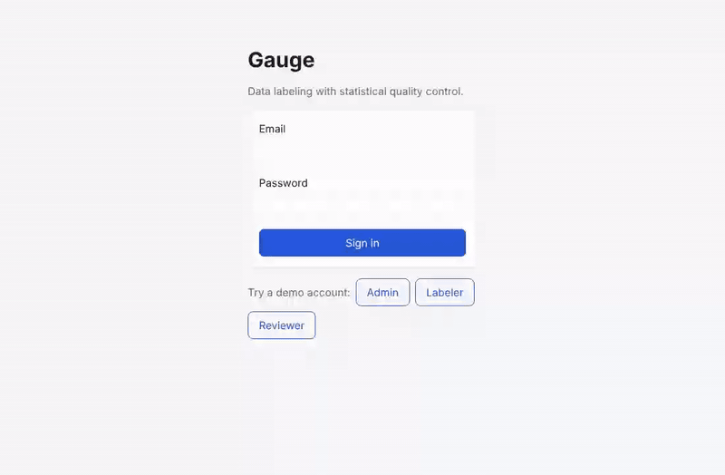
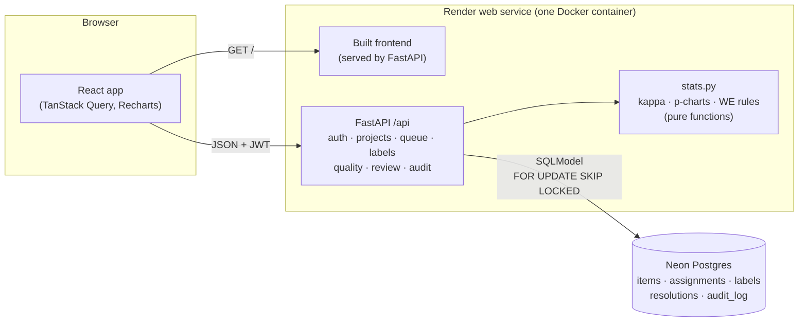
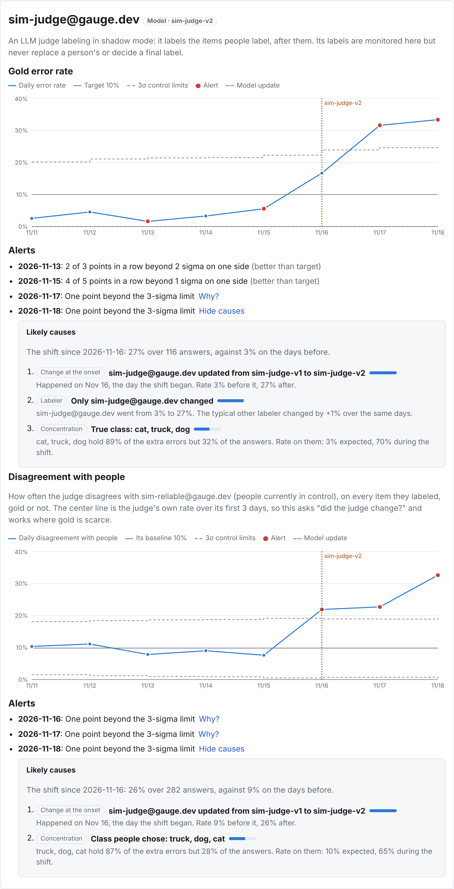
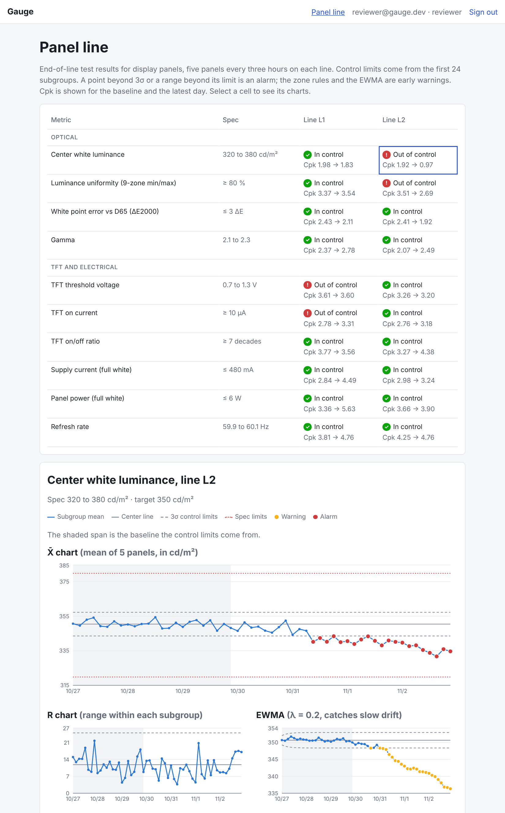
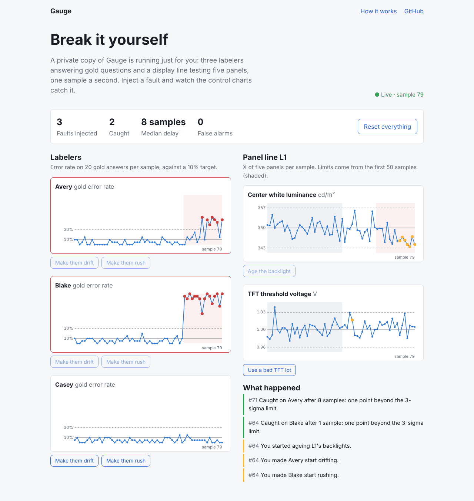

# Gauge

A data-labeling platform that monitors labeler quality the way a factory monitors a
production line.

Training data is only as good as the people who label it. Gauge mixes hidden **gold
questions** (known answers) into each labeler's queue, sends some items to several
labelers to measure **agreement**, and puts every labeler's error rate on a **control
chart**, so someone drifting out of control gets flagged before their labels reach the
dataset. The name comes from *Gauge R&R*, the measurement-system analysis quality
engineers use on factory gauges.



An **LLM judge** can label alongside the people in shadow mode, on the same control
charts plus one of its own, so a model update that quietly shifts its answers gets caught
too. When any chart raises an alert, Gauge **ranks the likely causes** (a change at the
onset, one labeler alone, or errors piled up in one class, batch or shift) with a
one-line reason for each. See [LLM judge](#llm-judge) and [Root cause](#root-cause).

Gauge also runs the same statistics on a **display panel production line**: simulated
end-of-line test data for color, luminance and uniformity, and for TFT backplane
electricals, on X̄/R and EWMA charts with Cpk. See [Panel line](#panel-line).

**Try it:** [the live demo](https://gauge-w270.onrender.com) opens on a landing page. **[Break it
yourself](https://gauge-w270.onrender.com/live)** streams a private, live copy of Gauge
where you inject faults (a drifting labeler, a rushing one, a quiet model update to the LLM
judge, an ageing backlight, a bad TFT lot) and watch the control charts catch them, with
the detection delay, any false alarms, and the ranked causes of each alarm. The landing
page also has one-click tours: catch the drifting labeler, catch the LLM judge after its
model update, watch a display line drift, or label images yourself. No sign-up. It runs on Render's free tier; a scheduled ping
([`keep-awake.yml`](.github/workflows/keep-awake.yml)) keeps it from going to sleep, so it
should open in seconds rather than after a minute's cold start.

## Stack

| Layer | Tools |
|---|---|
| API | Python 3.12, FastAPI, SQLModel, Alembic, Pydantic, JWT auth with roles |
| Database | Postgres 16 |
| Frontend | React, TypeScript, Vite, TanStack Query, React Router |
| Tests and CI | pytest against real Postgres, Vitest with Testing Library, ruff, oxlint, Prettier, GitHub Actions |

## Architecture



A labeler asks for the next item; the queue picks a gold item with probability
`gold_rate`, otherwise the next regular item that still needs labels, locking it so two
labelers never get the same one. Labels are written with an audit entry in the same
transaction. Quality reports are computed on read from the label table: small enough
at demo scale, and it keeps one source of truth (see the design notes for when that
would change).

## Design notes

- **Statistics as pure functions.** `stats.py` knows nothing about the database; it
  takes counts and returns kappas, chart points and rule violations. That made it easy
  to test against published examples (Fleiss 1971 gives κ = 0.210 on his data, and so
  does this code), and keeps the SQL in the service layer simple.
- **The center line is a target, not the labeler's own mean.** A textbook p-chart
  centers on the process average. Here that would let a consistently bad labeler look
  "in control". Centering on the project's `target_error_rate` flags them on day one.
  Limits are per day, because each day has a different number of gold answers.
- **Trusted labels, not banned labelers.** A label counts toward the final answer
  unless its labeler was out of control on the day it was given. Someone who drifts on
  day 6 keeps their good work from days 1 to 5. Items go to a person only when trusted
  labels can't settle them, which kept the simulated review queue to about 700 items rather
  than 1,081.
- **Postgres row locks for the queue.** `SELECT … FOR UPDATE SKIP LOCKED` hands out
  items without a separate queue service and without double assignment. It's also why
  the tests run against real Postgres rather than SQLite.
- **Simulated labelers through the real code path.** The demo data comes from four
  scripted labelers calling the same queue and label services as people do, so the
  dashboards are exercised end to end, and a slow CI test checks the drifter is caught
  on day 6.
- **Live demo sessions in memory, not in Postgres.** Each visitor's stream is its own
  `LiveDemo` object, so one person's faults never reach another's screen, and the free
  database can sleep while people watch. Sessions are capped and end after ten minutes.
  This only works with one instance; with more, fault requests would need sticky routing
  or a shared channel such as Redis pub/sub.
- **The LLM judge runs in shadow mode.** It labels the items people label, after them,
  and its labels never fill an item's required labels, count toward Fleiss' kappa, or
  decide a final label. That keeps the people's queue and agreement numbers exactly as
  they were, and makes the judge something you monitor before you trust it.
- **Two charts for a model, because gold is scarce.** The judge's gold p-chart works
  like anyone's, but gold is a small share of the work. Its second chart counts how
  often it disagrees with the people who are currently in control, on every item, gold
  or not, centered on its own first three days. In the simulated week that chart catches
  the model update on day 6, a day before gold does.
- **Root cause by arithmetic, not by a language model.** Every ranking comes from counts
  you can check by hand (extra errors, shares of answers, before-and-after rates), with
  the formulas in `app/rootcause.py`. A concentration has to beat the rest of the shift
  by a z of 3.5, since the set of classes is picked to look as bad as possible; at 3.0,
  about one healthy drift in ten showed a made-up class pattern in the live demo.
- **One container, one origin.** In production FastAPI also serves the built frontend.
  That means one free Render service, no CORS, and no API URL to wire between services.
  In development Vite serves the frontend and proxies `/api`.
- **Audited in the same transaction.** Creating users and projects, changing members,
  uploading items, labeling and resolving each write an audit entry (with before and
  after) in the transaction that makes the change, so the log can't drift from the data.

**What I'd change at scale:** compute daily quality aggregates incrementally (a table
updated on each label, or a materialized view) instead of on every dashboard read; move
the demo simulation into a one-off job; and add rate limiting and per-project roles
before letting strangers create projects on the public demo.

## Run it locally

With Docker:

```sh
docker compose up --build
```

Open http://localhost:5173 and pick a tour or a demo account. The API docs are at
http://localhost:8000/api/docs.

Without Docker (needs Postgres running locally, plus [uv](https://docs.astral.sh/uv/)
and Node 22 or newer):

```sh
cd backend
uv sync
uv run alembic upgrade head
uv run python -m app.seed      # demo accounts and the CIFAR-10 demo project
uv run python -m app.simulate  # a simulated week of labeling (about two minutes)
uv run uvicorn app.main:app --reload

cd ../frontend
npm install
npm run dev
```

### Demo data

`uv run scripts/fetch_cifar_sample.py` downloads 300 CIFAR-10 test images (30 per class)
into `frontend/public/cifar/`, and writes `backend/sample_data/cifar10_sample.csv`. Three
images per class carry their true label as a gold answer, and every row has its true
label in `true_label` for the simulation. The seed script loads that file into the demo
project.

Demo accounts all use the password `gauge-demo`:

| Email | Role |
|---|---|
| admin@gauge.dev | Admin: creates projects, uploads items, assigns members |
| labeler1@gauge.dev … labeler4@gauge.dev | Labeler: works through a queue |
| reviewer@gauge.dev | Reviewer: watches quality dashboards and resolves items in the review queue |
| sim-reliable, sim-noisy, sim-drifter, sim-rusher @gauge.dev | Simulated labelers |
| sim-judge@gauge.dev | Simulated LLM judge (a model account: nobody can sign in as it) |

## How quality is measured

| Signal | How |
|---|---|
| **Accuracy** | Each request draws a gold item (known answer) with probability `gold_rate`. Labelers can't tell gold from regular items, so gold accuracy is an honest sample of their work. |
| **Drift** | A [p-chart](https://en.wikipedia.org/wiki/P-chart) per labeler: gold error rate per day, with 3-sigma limits around the project's `target_error_rate`. The four [Western Electric rules](https://en.wikipedia.org/wiki/Western_Electric_rules) flag a labeler as out of control. The center line is a target, not the labeler's own average, so someone who is consistently bad is flagged too. |
| **Agreement** | A share (`overlap_rate`) of regular items go to `overlap_labelers` people. Fleiss' kappa covers the project; Cohen's kappa covers each pair of labelers. |
| **Speed** | Median time per label, and the share of labels under one second (rushing). |

The statistics live in `backend/app/stats.py` as pure functions, tested against textbook
examples (Fleiss 1971, among others).

### The drift demo

`uv run python -m app.simulate` labels for a simulated week with four labelers, through
the real queue: one reliable (95% right), one noisy (70%), one who drifts from 95% to 60%
on day 6, and one who clicks the first option in half a second every time. The drifter's
chart goes out of control on day 6, which a slow test in CI checks on every push.

## LLM judge



A model labeler (`users.is_model`) labels in **shadow mode**: after people label an item,
the judge labels it too, and every label records the model version that gave it
(`labels.model_version`). It appears on the quality page with a **Model** tag and two
charts:

| Chart | What it plots | Center line |
|---|---|---|
| Gold error rate | The same p-chart as everyone's | The project's target |
| Disagreement with people | How often it disagrees with in-control people, on every item they labeled (their majority where several did) | Its own rate over its first 3 days (phase I) |

A dotted line marks each day the model version changed, and a version change is stored
as a `model_update` event for [root-cause analysis](#root-cause).

In the simulated week, `sim-judge` runs `sim-judge-v1` (94% right) for five days, then a
"quiet" `sim-judge-v2` on day 6 that reads cats as dogs, dogs as cats and trucks as cars,
while staying right on the other seven classes. Overall gold accuracy still looks fine at
a glance (90% for the week); the disagreement chart flags day 6, and the gold chart
follows on day 7.

The simulated judge is deterministic (a hash of the item and the version) and needs no
API key, so the public demo costs nothing to run. A real one is optional:

```sh
uv sync --extra llm
export ANTHROPIC_API_KEY=...
uv run python -m app.judge --project 3 --provider anthropic --limit 50
```

That labels up to 50 items the judge hasn't seen with Claude (`GAUGE_JUDGE_MODEL`,
default `claude-opus-5-5`), constrained to the project's label options. Each run picks
up where the last stopped, so it can go on a schedule; changing the model shows up as a
model update on the charts. `--provider simulated --version sim-judge-v2` does the same
with the simulated versions.

## Root cause

When a Western Electric rule fires, **Why?** next to the alert (open by default for the
latest one) ranks the likely causes. `GET /api/projects/{id}/quality/labelers/{uid}/root-cause?day=…&chart=gold|agreement`
returns the same thing. How it works (`backend/app/rootcause.py`, pure functions):

1. **Find the shift.** A CUSUM change-point estimate picks where the shift that ends at
   the alert began. The days before it are the baseline, and the shift's *extra errors*
   are its errors beyond what the baseline rate predicts. A labeler bad from day one is
   compared with the target instead.
2. **Score each candidate from 0 to 1:**

   | Candidate | Score |
   |---|---|
   | A change at the onset: a model update, a guideline change (`POST /api/projects/{id}/events`), or a new batch (recorded on upload) | Share of the extra errors that came after it, if it happened up to 2 days before the shift began, or during it |
   | This labeler alone | How much of their change the typical (median) other person didn't share over the same days |
   | A concentration by true class, batch or shift | The largest gap between a set of values' share of extra errors and their share of answers: "3 classes hold 89% of the extra errors but 32% of the answers" scores 0.57 |

3. Keep candidates that score 0.15 or more and pass a significance check, and rank them.

On the simulated week, the judge's alert traces first to `sim-judge-v1 → v2` ("the day
the shift began, 3% before it, 27% after"), then to cat, truck and dog; the drifter's
traces to the drifter alone ("6% to 40%, the typical other labeler changed by −1%"); and
the rusher's to the rusher being far worse than everyone else. When nothing stands out,
it says so, which is what a chance alarm looks like.

## Review and final labels

A label is **trusted** unless its labeler's control chart was out of control (worse than
target) on the day they gave it. Each item's final label is a reviewer's resolution if
there is one, otherwise the majority of its trusted labels. Items with no trusted
majority (a tie, or only untrusted labels) go to the **review queue**, where a reviewer
sees every label, who gave it, and which were untrusted, and picks the answer. Items
whose trusted labels agree skip review even when an untrusted label disagreed, so
reviewers only see what the data can't settle on its own.

Admins can export final labels as CSV (`source` is `resolution`, `majority` or
`unresolved`). Every change, including each resolution with its before and after, is in
the audit log.

## Panel line

The same SPC engine, pointed at display manufacturing. **Panel line** (admins and
reviewers) watches end-of-line test results for two simulated production lines, with
five panels sampled every three hours.



| Group | Metric | How it's derived |
|---|---|---|
| Optical | Center white luminance | Center zone of a 3x3 luminance grid |
| | Luminance uniformity | Dimmest zone over brightest, in percent |
| | White point error | CIEDE2000 ΔE between the measured white's chromaticity and D65 |
| | Gamma | Least-squares fit to a 9-step gray ramp, in log-log space |
| TFT and electrical | Threshold voltage, on current, on/off ratio | Per-panel TFT test readings; the ratio in decades |
| | Supply current, panel power, refresh rate | Module test at full white |

Spec limits for each metric sit next to its definition in `backend/app/panel.py`.

**Charts.** Each line and metric gets an X̄/R chart (subgroups of 5) and an EWMA (λ =
0.2) of the subgroup means. Limits come from a three-day baseline (phase I), then stay
fixed while later subgroups are judged against them (phase II), so a drift can't drag
the limits along. Cpk is shown for the baseline and for the latest day, so a shrinking
margin to spec is visible before any panel fails.

**Alarms and warnings.** A point beyond 3σ, or a subgroup range above the R chart's
limit, is an alarm. The Western Electric zone rules and the EWMA are warnings. With
every rule as an alarm, a third of healthy charts alarmed in a typical simulated week,
because twenty charts each have a false alarm rate per point that adds up. Even with
only Shewhart alarms, about one healthy chart in four false-alarms per week. The demo's
fixed seed is one where the healthy charts stay quiet; `backend/app/panel_sim.py`
documents this, and its tests pin the seed.

**The demo week** (`uv run python -m app.panel_sim`, run on start with `GAUGE_DEMO=1`):

- **L2's backlight ages from day 4.** Luminance falls about 0.15% per subgroup, faster at
  the corners, so uniformity drops too. EWMA and zone-rule warnings come first, then a
  3σ alarm on day 5. Luminance Cpk falls from 1.92 to 0.97 while panels are still mostly
  in spec.
- **L1 builds from a bad TFT lot on day 6.** Vth runs 0.06 V high and on current 8% low.
  That is well inside spec but about 4.5σ on the X̄ chart, so both alarm at the lot's
  first subgroup and clear when the next lot arrives.
- The other sixteen charts stay in control.

The variables-chart math (`backend/app/spc.py`) and the colorimetry (`backend/app/panel.py`)
are pure functions, tested against hand-worked examples and Sharma, Wu and Dalal's
CIEDE2000 reference pairs.

## Live demo



The [Break it yourself](https://gauge-w270.onrender.com/live) page runs on two endpoints.
`GET /api/live/stream` starts a private, live version of both stories and streams it
over server-sent events: three labelers and an LLM judge answering gold questions and one panel line
testing five panels per subgroup, a sample a second. `POST /api/live/{id}/faults`
injects a fault into that stream:

| Fault | Target | What changes | Typically caught after (median) |
|---|---|---|---|
| `drift` | a labeler | Accuracy slides 3 points per sample from ~95% to 60% | 7 samples (2-of-3 beyond 2σ, or 3σ) |
| `rush` | a labeler | Clicks the first of ten options | 1 sample |
| `model_update` | the judge | Ships `judge-v2`, right only 30% of the time on cat, dog and truck | 2 samples |
| `backlight` | a line | Backlight ageing, as in the panel line week | 11 samples (the EWMA warns first) |
| `tft_lot` | a line | Eight subgroups from a lot with Vth 0.06 V high | 1 sample |

The demo knows which faults are active, so it grades its own detectors. An alarm on a
chart with a fault is reported as a detection with its delay in samples; an alarm on a
healthy chart is reported as a **false alarm**. Those happen: each panel chart crosses
3σ by chance about once in 370 points, so a few minutes of watching will usually show
one, and the demo labels it rather than hiding it. Delays above are medians over 200
seeds; `backend/app/live.py` has the model and `tests/test_live.py` pins the behavior.

Every alarm on a labeler chart carries its [root-cause](#root-cause) ranking, computed
from that labeler's last 40 samples of gold answers. Ship the judge a model update and
the alarm traces back to the update (in all of 200 seeds) and usually to the classes it
broke; make Avery drift and it traces to Avery alone.

## Deploy

Free hosting: [Render](https://render.com) runs the container and
[Neon](https://neon.tech) hosts Postgres. Both let you sign in with GitHub.

1. **Neon:** create a project (pick an AWS US West region to sit near Render's Oregon
   region) and copy its pooled connection string (host ending `-pooler…`). Migrations
   connect directly by dropping `-pooler` from the host; the server uses the pooler.
2. **Render:** choose **New → Blueprint**, connect this repository, and paste the Neon
   connection string when it asks for `GAUGE_DATABASE_URL`. Render reads
   [`render.yaml`](render.yaml), builds the root [`Dockerfile`](Dockerfile), generates
   the JWT secret, and deploys.
3. The first start runs migrations, creates the demo accounts, and starts the labeling
   simulation in the background (a few minutes). Pushes to `main` redeploy.

Set `GAUGE_DEMO` to `0` in Render to stop loading demo data.

To run the backend locally against Neon instead of Docker's Postgres, run `neon deploy`
(or `neon env pull`) in the repo root. It writes `DATABASE_URL` to `.env.local`, which
the backend reads when `GAUGE_DATABASE_URL` isn't set.

## Tests

```sh
cd backend && uv run pytest        # needs a gauge_test database; see tests/conftest.py
cd backend && uv run pytest -m slow   # the full simulation, about two minutes
cd frontend && npm test
```

The backend tests run against Postgres, not SQLite, because the labeling queue relies
on Postgres row locks (`SELECT … FOR UPDATE SKIP LOCKED`) so two labelers asking at the
same moment never get the same item. Each test runs in a transaction that is rolled
back afterwards.

CI also runs `alembic check`, which fails if the models and migrations drift apart.

## Uploading items

CSV or JSON with these fields. Rows with a `gold_answer` become gold items. An upload is
all-or-nothing, and errors name the row that failed.

| Task type | Fields |
|---|---|
| Image classification | `image_url`, `gold_answer` (optional) |
| Pairwise preference | `prompt`, `response_a`, `response_b`, `gold_answer` (optional) |

## Layout

```
backend/
  app/
    models.py         tables
    schemas.py        API request/response bodies (kept apart so hashes and gold answers can't leak)
    routers/          auth, users, projects, labeling, quality, events, review, audit log, panel line, live
    stats.py          kappa, p-charts, Western Electric rules (pure functions)
    rootcause.py      ranks likely causes of a chart alert (pure functions)
    judges.py         model labelers: the simulated judge and the optional Claude one
    judge.py          CLI that runs a judge over a project in shadow mode
    spc.py            X-bar/R, EWMA and Cpk for continuous measurements (pure functions)
    panel.py          panel metrics, spec limits, CIEDE2000, uniformity, gamma fit
    services/         queue selection, quality reports, judge runs, root cause, review queue, file ingest, audit log, panel line charts
    simulate.py       simulated labelers for the drift demo
    panel_sim.py      simulated display panel line for the panel line demo
  alembic/            migrations
  tests/
frontend/
  src/
    api.ts            typed API client
    auth.tsx          token and current-user context
    pages/            login, projects, project admin, labeling, quality, review, audit log, panel line
    components/       control charts (p-chart; X-bar, R and EWMA), status badge, item view
scripts/              demo data
Dockerfile            production image: API plus built frontend
render.yaml           Render Blueprint
```

## Roadmap

1. **Skeleton:** auth with roles, projects, upload, labeling UI, CI
2. **Quality engine:** gold mixing, overlap assignment, accuracy, Cohen's and Fleiss'
   kappa, p-charts with Western Electric rules, simulated labelers
3. **Dashboards and review:** per-labeler control charts, drift alerts, reviewer queue,
   audit log viewer
4. **Ship it:** deploy on Render and Neon, demo GIF, architecture diagram, design notes
5. **Panel line:** variables control charts, Cpk and a simulated display panel line,
   with optical (luminance, uniformity, ΔE2000, gamma) and TFT/electrical metrics

6. **LLM judge and root cause:** a model labeler in shadow mode with gold and
   agreement charts, a simulated model update, and ranked causes for every alert,
   live demo included

Next, if there's time: the pairwise preference labeling UI (the upload format already
supports it).
